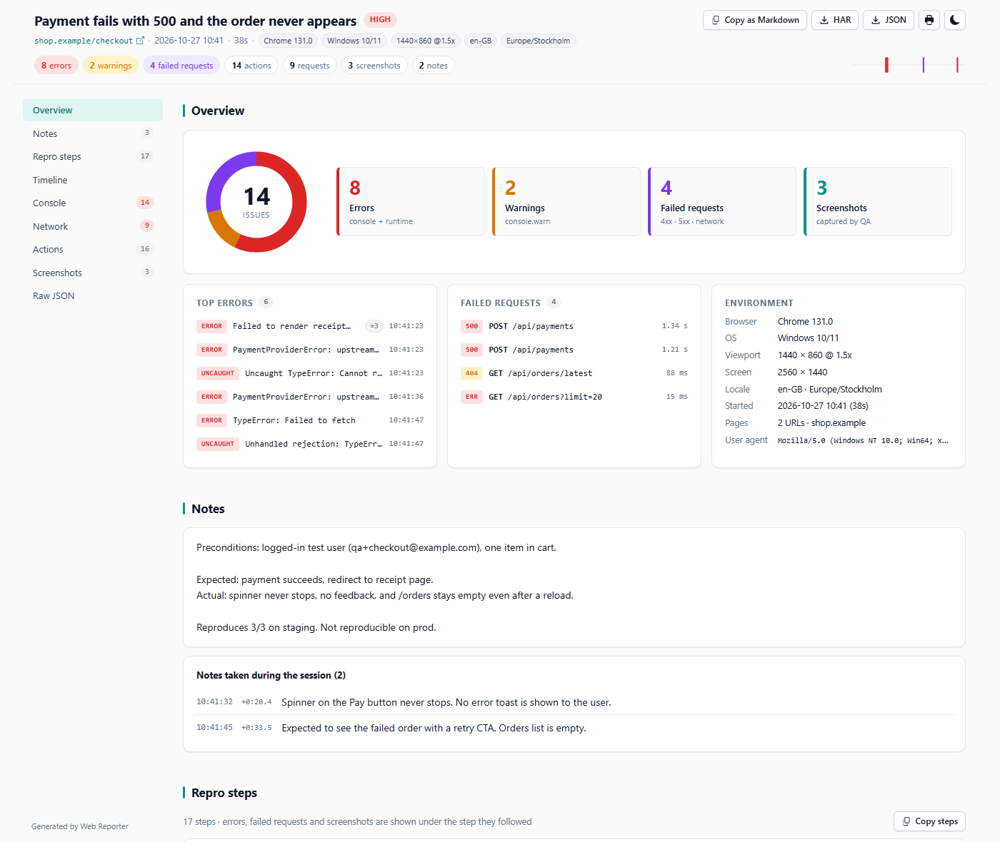

# Web Reporter

<p align="center">
  
</p>

A Chrome extension for QA engineers. Record a manual-test session locally and export a **single self-contained `.html` file** to hand to a developer. No server, no cloud, no shareable link — everything stays in the browser until you click Export.

See [PLAN.md](./PLAN.md) for the design rationale.

## Features

### Recording

- **One-click recording** of the current tab from the toolbar popup. The session is bound to that tab; activity in other tabs is ignored.
- **Zero overhead when idle.** Hooks are installed at page load but do nothing (no body cloning, no messaging) until you press Start.
- **Captures during a session:**
  - Page & browser metadata: URL, title, user agent, viewport, DPR, OS, locale, timezone.
  - Console output (`log` / `info` / `warn` / `error` / `debug`), uncaught errors and unhandled rejections with stack traces.
  - User actions: clicks (with visible label), form inputs, submits, SPA navigations, and special keys (Enter, Escape, Tab, arrows, Ctrl/Cmd shortcuts — never typed characters).
  - **HAR-lite network log:** every `fetch` and `XMLHttpRequest` with method, URL, status, duration, size, headers and (text-like) bodies.
  - Screenshots on demand — from the popup or with **Alt+Shift+S** without opening it. JPEG by default, PNG optional.
  - **Timestamped notes** typed in the popup while testing ("spinner never stops") — they show up as steps in the report.
  - Title, severity (low / medium / high / critical) and free-text notes.
- **Live status** in the popup: elapsed time, counters per category, estimated report size, and a warning when you've wandered to another tab.
- **REC badge** on the toolbar icon while a session is running.
- **Settings page** for screenshot format/quality, what to capture, body size limit and event cap. Changes apply instantly, even mid-session.

### Report

A single HTML file that opens offline by double-clicking. Light and dark themes, printable.

- **Overview** — issue donut, top errors (grouped and counted), failed requests and environment. Everything is clickable and jumps to the matching row.
- **Repro steps** — numbered actions with the errors, failed requests and screenshots that followed each one, plus relative timestamps.
- **Timeline** — one lane per category with a time axis, hover tooltips and click-to-jump.
- **Console** — level filters, text search, consecutive duplicates collapsed with a count, expandable stack traces.
- **Network** — status filters, search, sortable columns, duration bars, headers and pretty-printed bodies, **Copy as cURL**.
- **Screenshots** — lightbox with keyboard navigation and download.
- **Copy as Markdown** — a paste-ready bug report (steps, errors, failed requests, environment) for Jira, GitHub or Linear.
- **Download HAR** (with headers and bodies) for DevTools → Network → Import, and **Download JSON** of the raw session.

### Privacy

- **100 % local.** The extension never calls a third-party endpoint. The only network traffic during recording is the page's own.
- Captured data lives in IndexedDB and `chrome.storage.local` and is wiped when you export or discard.
- **Default-on redaction:** password and `tel` inputs, anything whose name/id matches `password | secret | token | otp | cvv | ssn | credit | card`, and credit-card autocomplete fields only record their length and a `redacted: true` flag. `Authorization`, `Cookie`, `Set-Cookie` and `X-*-Token` headers are replaced with `[REDACTED]`.
- Open the exported `.html` in a text editor if you want to verify what's inside before sharing.

## Install (load unpacked)

```bash
npm install
npm run build
```

Then in Chrome:

1. Go to `chrome://extensions`.
2. Toggle **Developer mode** (top-right).
3. Click **Load unpacked** and select the `dist/` folder.
4. Pin the extension from the puzzle icon for easy access.

Chrome will ask for the `<all_urls>` host permission — required so screenshots and content scripts work across navigation.

## Use

1. Open the page you want to test and click the toolbar icon. Enter a **title**, pick a **severity**, optionally write **notes**.
2. Click **Start recording**. If the page was open before the extension was installed, the popup offers to reload it.
3. Use the website normally. Open the popup any time to take a screenshot, add a timestamped note, or tweak the title — the popup is just a view; the session lives in the service worker.
4. Click **Export report** and pick where to save the `.html` file. The session is cleared after a successful export (cancelling the save dialog keeps it).
5. **Discard session** (click twice) throws the recording away.

The exported HTML opens in any browser. Send it via Slack, attach it to Jira, drop it into a GitHub issue — it's just one file. Inside the report, **Copy as Markdown** gives you the text for the ticket body.

## Known limitations

- **HAR-lite** captures `fetch` and `XMLHttpRequest` only. It does **not** see image, script, or CSS resource loads, CORS preflights, WebSockets, or requests fired before the content script attached.
- Pages with a strict CSP that blocks `world: MAIN` injection (some banking sites, some Google products) silence console and network capture. Page metadata, clicks and inputs still work.
- `chrome.tabs.captureVisibleTab` cannot screenshot `chrome://` pages or the Chrome Web Store, and the recorded tab must be the visible one.
- One tab per session. Full-page navigations within that tab are fine; opening the flow in a new tab is not captured.
- The popup closes when it loses focus — that's Chrome's default popup behaviour. Reopen it; nothing is lost.

## Develop

```bash
npm run dev          # Vite dev mode, watches popup/options/SW/content
npm run build        # Production build into dist/
npm run typecheck    # tsc --noEmit
npm test             # Vitest (one-shot: npm test -- --run)
npm run sample       # Build sample/report.html (+ report-dark.html) with fake data to iterate on the viewer
npm run icons        # Regenerate public/icons/*.png
npm run build:viewer # Rebuild only the inlined report bundle
```

The report viewer (`src/report/viewer.ts` + `viewer.css`) is bundled separately by [`scripts/build-viewer.mjs`](scripts/build-viewer.mjs) into `src/report/_bundle.ts`, which the service worker imports as strings to inline into each export. `_bundle.ts` is regenerated by the `pre*` hooks and is gitignored. The viewer's data logic (`model.ts`, `markdown.ts`, `har.ts`) is DOM-free and unit-tested.

### Layout

```
src/
├── background/      # service worker: session state, IndexedDB, screenshots, badge, exporter
├── content/         # isolated-world bridge + page-world (MAIN) hooks, gated by recording state
├── popup/           # toolbar UI
├── options/         # settings page
├── report/          # viewer (model + markdown + har + DOM) bundled into every export
├── shared/          # message contracts, schema, settings, redaction rules
└── tests/           # vitest unit tests
scripts/             # build-viewer, make-sample, gen-icons
public/icons/        # generated extension icons
```

## Status

0.2.0 — recording engine, popup, settings and report redesigned. Ideas for later are listed in [PLAN.md](./PLAN.md).
